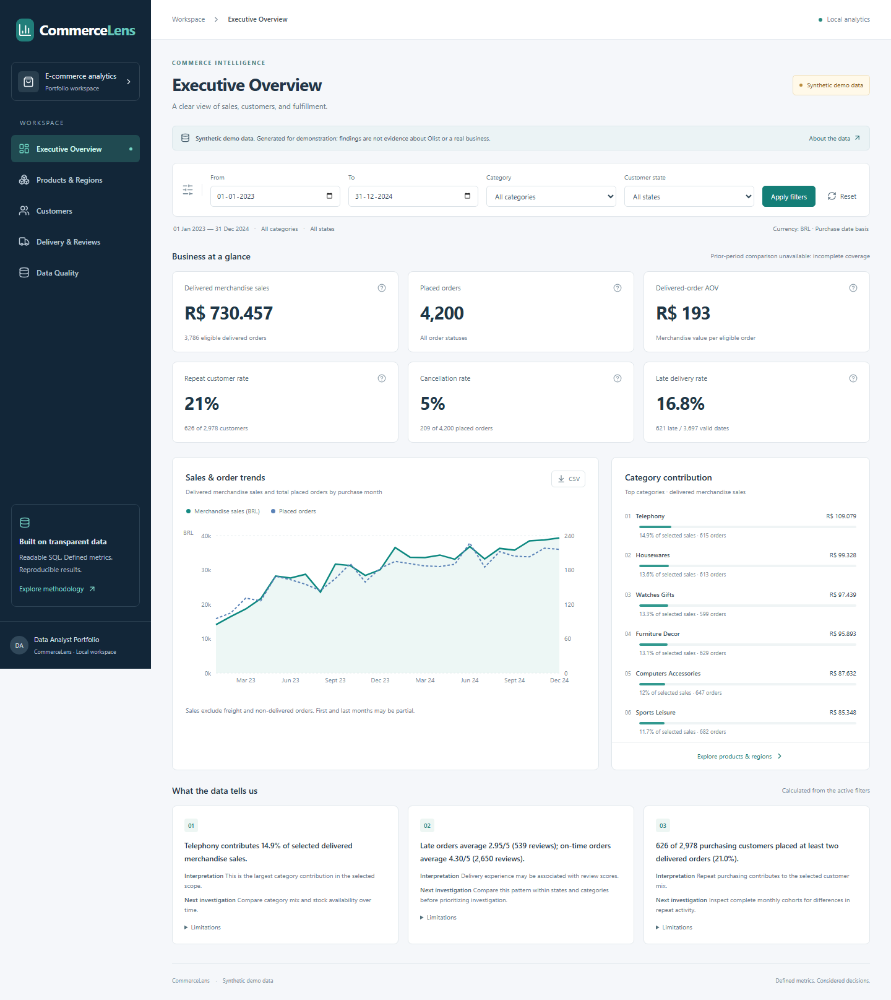
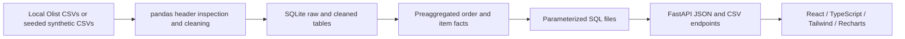

# CommerceLens

A locally runnable e-commerce analytics portfolio for an entry-level Data Analyst. Demonstrates pandas cleaning, analytical SQL, KPI design, validation, and careful business interpretation through a React dashboard. No Streamlit, Gradio, paid API, external database server or Docker required.

**The included working demo is synthetic.** No Olist CSVs were provided or downloaded. Synthetic observations are not evidence about Olist or a real business.



## Run on Windows

Prerequisites: Python 3.11+ and a current Node.js LTS with npm. Commands below use the project's `.venv` directly; activating it or changing PowerShell execution policy is unnecessary. `npm.cmd` avoids the PowerShell script-policy issue with `npm.ps1`.

First-time setup:

```powershell
cd D:\CommerceLens
python -m venv .venv
.\.venv\Scripts\python.exe -m pip install -r requirements.txt
.\.venv\Scripts\python.exe -m backend.pipeline --mode demo
.\.venv\Scripts\python.exe -m scripts.report
cd frontend
npm.cmd ci
npm.cmd run build
```

Terminal 1 — API:

```powershell
cd D:\CommerceLens
.\.venv\Scripts\python.exe -m uvicorn backend.main:app --host 127.0.0.1 --port 8000
```

Terminal 2 — dashboard:

```powershell
cd D:\CommerceLens
cd frontend
npm.cmd run dev
```

Open **http://127.0.0.1:5173**. API documentation: **http://127.0.0.1:8000/docs**. Stop each terminal with Ctrl+C. Keep the API running when previewing a production build with `npm.cmd run preview` (http://127.0.0.1:4173).

All application paths are derived from the project location; no D-drive paths are embedded in application code. To relocate, copy the source, change `cd`, then recreate `.venv` and install dependencies. No environment variables or secrets are needed. Vite proxies `/api` to the loopback API in development and preview.

## Use real Olist CSVs

Visit the official [Brazilian E-Commerce Public Dataset by Olist on Kaggle](https://www.kaggle.com/datasets/olistbr/brazilian-ecommerce). Sign in and accept any applicable terms, then download through Kaggle's authorized workflow. Review the dataset's license before redistributing it. This project does not bypass authentication or bundle third-party data.

Extract these seven files directly into `data/raw/` (not a nested archive directory):

```text
olist_orders_dataset.csv
olist_order_items_dataset.csv
olist_customers_dataset.csv
olist_products_dataset.csv
product_category_name_translation.csv
olist_order_payments_dataset.csv
olist_order_reviews_dataset.csv
```

Stop the API before replacing the database on Windows, then inspect and ingest:

```powershell
cd D:\CommerceLens
.\.venv\Scripts\python.exe -m backend.pipeline --inspect --source data\raw
.\.venv\Scripts\python.exe -m backend.pipeline --mode real --source data\raw
.\.venv\Scripts\python.exe -m scripts.report
.\.venv\Scripts\python.exe -m uvicorn backend.main:app --host 127.0.0.1 --port 8000
```

Refresh the dashboard to load the new date range. No frontend rewrite is required. `--mode auto` (the default) uses `data/raw` when CSVs are present, otherwise generates demo files in `data/demo`. A partial or invalid real dataset fails visibly; it does not silently switch to synthetic data. `--mode demo` explicitly rebuilds the deterministic seed-42 demo.

## Dashboard

| Page | What it demonstrates |
|---|---|
| Executive Overview | Six KPIs, immediately preceding equal-duration comparisons, sales/order trends, category mix, structured observations and caveats |
| Products & Regions | Sortable category and customer-state tables, rate sample sizes, filtered CSV exports |
| Customers | Customer identity, repeat purchasing within the selected window, purchase frequency, cohort heatmap |
| Delivery & Reviews | Calendar-day delivery duration, late rates, state comparisons, latest-review scores and sample sizes |
| Data Quality & Methodology | Actual inspected columns, row counts, missingness, invalid values, orphans, exclusions, key checks and metric definitions |

Dates are inclusive and use order purchase date. Category sales count matching items only; category order metrics select containing orders. AOV becomes matching-category spend per eligible containing order. Cohorts explicitly ignore category/state filters and retain global first-purchase history. Data quality is dataset-wide. CSVs use the same SQL and filters as the dashboard and carry source/filter metadata. Column sorting changes display order, not the exported population.

Currency cards round to whole BRL for readability; CSVs and the report retain underlying precision. Changes in rates are relative percentages, not percentage points. Charts use chronological monthly points; dates at the edges may represent partial months. Zero-denominator metrics are unavailable.

## Architecture



```text
backend/
  demo.py             Deterministic Olist-shaped demo generator
  pipeline.py         Header inspection, cleaning, quality report, atomic rebuild
  analytics.py        Parameter validation, SQL orchestration, deterministic findings
  main.py             FastAPI JSON, methodology and CSV routes
  sql/                Commented model, scope and analytical queries
  tests/              Tiny adversarial fixtures and reproducibility checks
frontend/
  src/                Five-page responsive dashboard
  e2e/                Playwright checks and screenshot capture
data/
  raw/                User-supplied CSVs (ignored)
  demo/               Generated CSVs (ignored)
  commerce.sqlite     Rebuilt local database (ignored)
docs/                 Dictionary, methodology, analysis, walkthrough, screenshots
scripts/report.py     Rebuild analysis snapshot and metric documentation
```

The model aggregates item and payment detail independently, and uses `ROW_NUMBER` to select one review. A category filter uses `EXISTS` to select orders without multiplying rows. SQL demonstrates joins, CTEs, CASE, aggregates, window ranking and recursive cohort month scaffolding. Query values are bound parameters; export tables use an allowlist.

## Verification

Backend:

```powershell
cd D:\CommerceLens
.\.venv\Scripts\python.exe -m pytest backend\tests -q
```

Frontend build:

```powershell
cd D:\CommerceLens
cd frontend
npm.cmd run build
```

Browser checks (start both servers first; installing Chromium requires network access once):

```powershell
cd D:\CommerceLens
cd frontend
npx.cmd playwright install chromium
npx.cmd playwright test
```

See [verification results](docs/verification.md), [data dictionary](docs/data-dictionary.md), [metric dictionary](docs/metric-dictionary.md), [analysis report](docs/analysis-report.md), and [interview walkthrough / resume bullets](docs/interview-walkthrough.md).

## Limits

This is a local, single-user portfolio application with no authentication or production deployment configuration. Real Olist files have not been executed in this build; their required schema is validated at runtime. Review association is not causal. Cohorts are based on first observed purchase, not necessarily lifetime first purchase. Current order status can bias recent periods. No unsupported margin, profit, return, discount or acquisition-channel metrics are inferred.

Ingestion rebuilds a sibling database and replaces the prior one after validation; it does not append. Run one ingestion process at a time and stop the API during replacement on Windows. Large CSVs are read into memory. Database files, source CSVs, dependencies, logs and secrets are excluded from version control.
